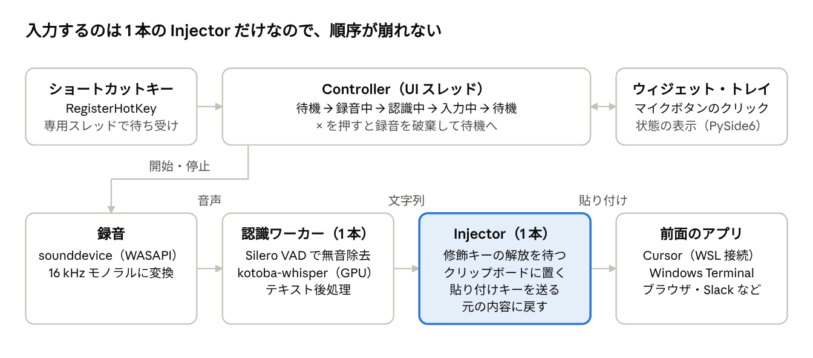
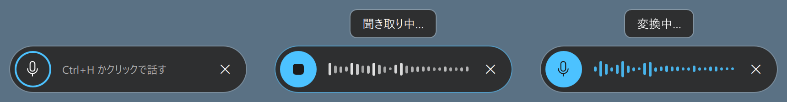
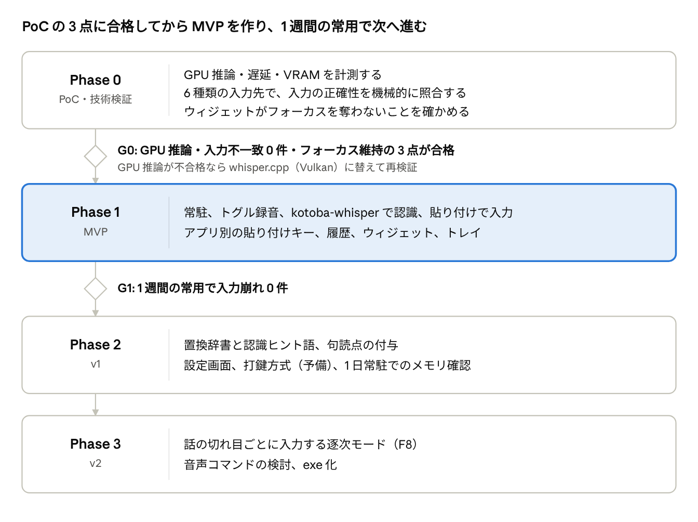

# kotoba-whisper ローカル音声入力アプリ 設計書

Oct 16, 2026 · @MatsumotoAkira

## 1. 概要

Windows に常駐し、ショートカットキーで録音している間に話した日本語を kotoba-whisper で GPU 推論して、そのときフォーカスされているテキスト欄へ入力する個人用の音声入力アプリを作る。処理はすべてローカルで完結し、モデル取得後はネットワークを使わない。

- 動作環境: Windows 11 ネイティブのタスクトレイ常駐アプリ（WSL 内では動かさない）
- 推論: NVIDIA GPU（CUDA）
- 主な入力先: Cursor（WSL リモート接続）のエディタ・チャット欄・統合ターミナル、Windows Terminal 上の WSL シェルと Claude Code などの TUI、ブラウザや Slack などの一般アプリ

**スコープ外**: 音声ファイルの文字起こし、話者分離、翻訳・要約、「改行」「送信」などの音声コマンド（音声コマンドは将来検討）。

## 2. 結論サマリ

技術的には実現可能。最大の難所は認識ではなく WSL・ターミナルへ文字を崩さず渡すことで、**1 文字ずつ打鍵せず、クリップボード経由の 1 回の貼り付けとして渡す**方針で解決する。

| 論点 | 判定 | 推奨 |
| --- | --- | --- |
| kotoba-whisper を Windows + GPU で動かす | 可能 | faster-whisper + kotoba-whisper-v2.0-faster（FP16） |
| RTX 5060 Ti（Blackwell）対応 | 可能（版の指定が必要） | CTranslate2 4.6.3 以降（CUDA 12.8 対応）。Blackwell では INT8 が無効なので FP16 |
| 常駐 + ショートカットキー | 可能 | タスクトレイ常駐、RegisterHotKey で開始・終了（トグル）、Win+H 風のウィジェット |
| フォーカス中の欄へ入力 | 可能 | クリップボード貼り付け（アプリ別に貼り付けキーを切替）、予備に Unicode 打鍵 |
| WSL・ターミナルへの正確な入力 | 可能（PoC で検証） | 貼り付け方式。打鍵方式は IME をオフにしたときだけ使う |
| 低遅延 | 見込みあり（未計測） | 話し終わりから入力まで 1 秒以内を目標に PoC で計測 |

確認済みの手元環境: NVIDIA GeForce RTX 5060 Ti（VRAM 8 GB、ドライバ 610.88）、Windows 11 Home（build 26200）、Windows 側に uv 0.11.1 が導入済み（Python 3.14 は uv が用意する）。同じ発想の OSS として [Handy](https://github.com/cjpais/Handy) があり、貼り付け方式の設計は参考にできる。

## 3. 要件

最優先は「入力された文字列が認識結果と 1 文字も違わないこと」。速度はその次に置く。

### 機能要件

| ID | 要件 | フェーズ |
| --- | --- | --- |
| F1 | ログオン時に自動起動してタスクトレイに常駐。モデルは起動時に GPU へ読み込み、常駐中は保持 | MVP |
| F2 | ショートカットキーを押して録音開始、もう一度押して終了（トグル）。終了した時点の内容をまとめて 1 回で入力する。キーは設定で変更 | MVP |
| F3 | 録音終了後に kotoba-whisper で日本語認識し、その時点でフォーカスされている欄のカーソル位置へ挿入 | MVP |
| F4 | Enter は送らない（ターミナルでのコマンド実行やチャットの誤送信を防ぐ）。改行も除去して 1 行で渡す | MVP |
| F5 | Windows 標準の音声入力に似た小さなウィジェットで録音中・認識中を表示。クリックでも開始・終了でき、クリックしても入力先のフォーカスを奪わない | MVP |
| F6 | 直近の認識結果を履歴として保持し、トレイや別キーから再入力できる（入力失敗時の救済） | MVP |
| F7 | 置換辞書（例: 「クロードコード」→「Claude Code」）と認識ヒント語の登録 | v1 |
| F8 | 話の切れ目ごとに順次入力する逐次モード（長めの発話向け） | v2 |

### 非機能要件

| 項目 | 目標 |
| --- | --- |
| 正確性 | WSL ターミナルを含む全対象で、順序の入れ替わり・欠落・重複・意図しない IME 変換が 0 件 |
| 遅延 | 終了のキーを押してから入力完了まで 1.0 秒以内（10 秒以下の発話） |
| 常駐負荷 | 待機中の CPU はほぼ 0%。VRAM は他の GPU 作業と共存できる 3 GB 以内 |
| プライバシー | 完全ローカル。音声と認識結果は既定でディスクに保存しない（デバッグ時のみ明示的に有効化） |
| 権限 | 管理者権限なしで動作する（管理者として動くウィンドウへの入力は対象外） |

## 4. 技術調査1: モデルと推論エンジン

公式の CTranslate2 変換版 kotoba-whisper-v2.0-faster を faster-whisper で FP16 実行するのを第一候補にする。Python から直接使え、VAD も内蔵しているため。

### モデル

kotoba-whisper v2.0 は Whisper large-v3 のエンコーダをそのまま使い、デコーダを 2 層に蒸留した 756M パラメータのモデル。large-v3 比 6.3 倍速とされる（distil-large-v3 と同構造での値）。CER は CommonVoice 8 / JSUT / ReazonSpeech で 9.2 / 8.4 / 11.6%（large-v3 は 8.5 / 7.1 / 14.9%）。

| モデル | 形式 | 特徴 | 本アプリでの扱い |
| --- | --- | --- | --- |
| [kotoba-whisper-v2.0-faster](https://huggingface.co/kotoba-tech/kotoba-whisper-v2.0-faster) | CTranslate2 | v2.0 の公式変換。FP16 重み | 第一候補 |
| [kotoba-whisper-v2.0-ggml](https://huggingface.co/kotoba-tech/kotoba-whisper-v2.0-ggml) | whisper.cpp | v2.0 の公式変換 | whisper.cpp を使う場合の代替 |
| [kotoba-whisper-v2.1](https://huggingface.co/kotoba-tech/kotoba-whisper-v2.1) / [v2.2](https://huggingface.co/kotoba-tech/kotoba-whisper-v2.2) | transformers | v2.0 に後処理を足したもの。句読点付与（punctuators）、v2.2 は話者分離も | モデル自体は使わず、句読点が欲しければ punctuators だけ後段に入れる |
| [kotoba-whisper-bilingual-v1.0-faster](https://huggingface.co/kotoba-tech/kotoba-whisper-bilingual-v1.0-faster) | CTranslate2 | 日英対応 | 英語混じりが多ければ切替候補 |

v2.0 単体では句読点が安定して付かない前提で設計する（v2.1 で句読点が後処理として追加された経緯からの推定。PoC で確認）。

### 推論エンジン

| エンジン | Windows + RTX 5060 Ti | 長所 | 短所 |
| --- | --- | --- | --- |
| [faster-whisper](https://github.com/SYSTRAN/faster-whisper)（CTranslate2） | [CTranslate2 4.6.3](https://github.com/OpenNMT/CTranslate2/releases) で CUDA 12.8 対応。Blackwell（sm120）では INT8 が無効化されているので FP16 を使う | Python で完結。Silero VAD 内蔵。公式変換モデルあり | cuBLAS（CUDA 12）の DLL 配置が必要。cuDNN は 4.6.3 以降は任意 |
| whisper.cpp | CUDA 12.8 以降でビルド、または Vulkan 版（ドライバだけで動く） | 依存が軽く配布しやすい | Python からはバインディング経由。VAD は別途 |
| transformers + PyTorch | PyTorch の CUDA 12.8 版が必要 | v2.1 / v2.2 のパイプラインがそのまま動く | 依存が数 GB と重く、起動も遅い |

推論エンジンは差し替え可能なインターフェース（`transcribe(audio) -> str`）の裏に置き、faster-whisper で問題が出たら whisper.cpp（Vulkan）へ逃がせるようにしておく。

### 速度と VRAM の見積もり（未計測）

- Whisper のエンコーダは発話の長さに関係なく 30 秒分の窓を処理するため、1 回の認識コストは 30 秒以下ならほぼ一定。デコーダが 2 層なので文字数による増加は小さい。
- FP16 の重みは約 1.5 GB（756M × 2 バイト）。作業領域を含め 3 GB 以内に収まるかを PoC で測る。
- 初回推論は CUDA 初期化で遅いので、起動時に無音 1 秒でウォームアップする。

### 推奨パラメータ（初期値）

`language="ja"`, `condition_on_previous_text=False`（公式例と同じ）, `without_timestamps=True`, `beam_size=1`（速度優先。精度不足なら 5 と比較）, `vad_filter=False`（VAD は録音側でかける。第 5 章）。専門用語は `hotwords` / `initial_prompt` で寄せるが、長いプロンプトはハルシネーションの原因になるので短く保つ。

## 5. 技術調査2: ホットキー・録音・VAD

ホットキーは低レベルフックを使わず RegisterHotKey で受け、押すたびに録音の開始と終了を切り替える（トグルのみ）。録音は 16 kHz モノラルに変換し、Silero VAD で無音を切り落としてから認識に渡す。

### グローバルホットキー

| 方式 | 仕組み | リスク | 採用 |
| --- | --- | --- | --- |
| [RegisterHotKey](https://learn.microsoft.com/en-us/windows/win32/api/winuser/nf-winuser-registerhotkey) | 押下で WM\_HOTKEY が届く（`MOD_NOREPEAT` でオートリピートを抑止）。トグルなら押下だけ分かれば足りる | 他アプリと同じキーは登録に失敗する（起動時に通知） | 採用 |
| 低レベルキーボードフック（WH\_KEYBOARD\_LL） | すべてのキーの押下と解放を横取りする | コールバックが最大 1 秒を超えると Windows 7 以降は[黙ってフックが外される](https://learn.microsoft.com/en-us/windows/win32/winmsg/lowlevelkeyboardproc)。Python の GIL と推論が重なると起き得る | 不採用 |

- 操作はトグルのみ: 1 回押すと録音開始、もう 1 回押すと終了してまとめて入力する。
- 既定のキーは `Ctrl+H`。RegisterHotKey で登録したキーはどのアプリにも届かなくなるため、各アプリの Ctrl+H（VS Code / Cursor の置換、ブラウザーの履歴、ターミナルの Backspace 相当など）は使えなくなる。困る場合は設定で変える。F12 は OS 予約、Win キーの組み合わせも OS 用なので避ける。
- **修飾キーが押されている間は入力しない**: 終了のキーを押した直後は Ctrl や Alt がまだ押されていることがある。そのまま貼り付けキーを送ると別のショートカットに化けるため、入力の直前に Ctrl / Alt / Shift / Win がすべて離されるのを待つ。修飾キー無しの単独キーならこの待ちは発生しない。

### 録音

- sounddevice（PortAudio）で WASAPI 共有モードの入力を開き、デバイス本来のレート（通常 48 kHz）で取り、soxr で 16 kHz モノラル float32 に変換する。
- マイクはホットキー押下時に開き、終了で閉じる（常時開いているとタスクバーのマイク使用中表示が消えないため）。
- 手元のマイクは開いてから最初の音が届くまで約 460 ms かかり、その間の音は失われた（Phase 0 で計測）。そのため最初の音が届いてからウィジェットを「聞き取り中…」にして、話し始めてよいことを知らせる。設定 `audio.keep_open = true` では常時開き＋直前 300 ms を保持するリングバッファに切り替わる（既定はオフ。P0-12 で判断）。
- 入力デバイスは設定で固定できるようにし、未指定なら OS の既定マイク。

### VAD とハルシネーション対策

Whisper 系は無音や雑音だけの入力に「ご視聴ありがとうございました」のような存在しない文を出すことがあるため、認識の前後で止める。

1. Silero VAD（CPU で動く小型モデル）で発話区間を検出し、前後の無音を切る。発話が 0.3 秒未満なら認識しない（誤押し対策）。無音・雑音だけの入力から出る「ごめん」などはここで止まる（Phase 0 で確認）。
2. `condition_on_previous_text=False` で前の出力に引きずられないようにする。
3. `no_speech_prob` が高い区間は捨てる。ただし無音でも 0.1 程度しか出なかったので、実際の除外は 1 の VAD に頼る。
4. 出力全体が禁止フレーズ一覧（設定ファイルで管理）に一致したら入力しない。

**長い発話は区切って認識する**: v2.0 に 23 秒の発話を 1 回で渡すと、デコード設定を変えても最後の文が丸ごと抜けた（Phase 0 で確認）。VAD で見つけた発話区間を 15 秒以内（`audio.max_chunk_s`）のかたまりにまとめ、かたまりごとに認識してつなげる。23 秒の発話で 0.48 秒。

## 6. 技術調査3: 入力方式と WSL・ターミナル対策

既定の入力方式は「クリップボードに置いて貼り付けキーを 1 回送る」。文字列全体が 1 回の貼り付けとして届き IME も通らないので、過去に WSL で起きた順序の入れ替わりと変換崩れの両方を根本から避けられる。

### 入力方式の比較

| 方式 | 仕組み | 順序 | IME の影響 | 対応範囲 | 採用 |
| --- | --- | --- | --- | --- | --- |
| クリップボード貼り付け | 文字列をクリップボードに置き、貼り付けキーを SendInput | 1 回で全体が届く | 受けない | ほぼ全アプリ。ターミナルは貼り付けキーを合わせる | 既定 |
| Unicode 打鍵 | SendInput（KEYEVENTF\_UNICODE）で 1 文字ずつ | 1 文字ずつ別イベントなので、途中の非同期処理で崩れ得る | IME が ON だと混ざり得る。一時的に IME を OFF にする | 多くの GUI アプリ | 予備（アプリ別に指定） |
| UI Automation の値設定 | 入力欄の値を丸ごと置換 | — | 受けない | 標準コントロールのみ。カーソル位置への挿入にならず、ターミナル不可 | 不採用 |

### WSL で順序入れ替わり・変換崩れが起きる原因（推定）

1. **IME が ON のまま打鍵した**: 英字を仮想キーとして送ると IME がローマ字として受け、未確定文字列にする。直接入る文字と未確定文字列が混ざり、確定のタイミングで前後が入れ替わったり勝手に変換されたりする。
2. **ターミナル側の IME 処理が非同期**: VS Code / Cursor の統合ターミナルが使う xterm.js では、v6 系が IME 確定文字列を `setTimeout(0)` で遅らせて送るため、直後のキーが先に届いて順序が入れ替わる事例がある（[Wave Terminal の PR #3264](https://github.com/wavetermdev/waveterm/pull/3264)、韓国語で「이런 문제」→「이 런문제」）。Windows Terminal も 1.21 で IME 実装を書き直しており、IME 絡みの不具合報告が続いている。
3. **中継段が多い**: 打鍵は「アプリ → ConPTY または Cursor のリモート接続 → WSL の pty → シェル / TUI」と流れ、1 文字ずつが独立したイベントになる。どこか一段でも非同期処理があれば崩れ得る。Claude Code など TUI 側での取りこぼし報告もある。

貼り付けはこの 3 つをすべて通らない。ターミナルは貼り付けを bracketed paste（`ESC[200~` … `ESC[201~`）で囲んで 1 回で書き込むので、シェルや TUI も「貼り付け」として一括処理する。

### アプリ別の貼り付けキー

| 対象 | 判定（前面ウィンドウのプロセス） | 貼り付けキー | 根拠 |
| --- | --- | --- | --- |
| Windows Terminal（WSL / PowerShell） | `WindowsTerminal.exe` | Shift+Insert | 既定で Ctrl+V / Ctrl+Shift+V / Shift+Insert がすべて貼り付け（[公式](https://learn.microsoft.com/en-us/windows/terminal/customize-settings/actions)）。Vim 用に Ctrl+V を外す人がいるので Shift+Insert。[Handy](https://handy.computer/docs/paste-methods) も同じ推奨 |
| Cursor / VS Code（エディタ・チャット・統合ターミナル） | `Cursor.exe` / `Code.exe` | Ctrl+V | Windows 版は統合ターミナルも Ctrl+V で貼り付け。同じウィンドウ内なのでエディタとターミナルは区別しない |
| コンソールホスト（従来の cmd / PowerShell ウィンドウ） | ウィンドウクラス `ConsoleWindowClass` | Shift+Insert | 従来からの貼り付けキー |
| その他 | 上記以外 | Ctrl+V | 標準 |

### クリップボードを使うことの副作用と対策

- **元の内容が消える** → 貼り付け前に退避し、貼り付け後に戻す。戻す前にクリップボードの更新番号（GetClipboardSequenceNumber）を確かめ、自分が置いた後に誰かが書き換えていたら戻さない。
- **戻すのが早すぎると古い内容が貼られる** → 貼り付けキー送信後、待ち時間を置いてから戻す（初期値 300 ms、アプリ別に調整可。Handy は置いてから送るまでの待ちが 60 ms）。
- **Win+V の履歴や他端末への同期に残る** → 登録形式 `ExcludeClipboardContentFromMonitorProcessing` を一緒に置くと、履歴にも同期にも入らない（[Microsoft 公式](https://learn.microsoft.com/en-us/windows/win32/dataxchg/clipboard-formats)）。

### その他の制約

- **管理者として動くウィンドウ**には、通常権限のアプリから SendInput が届かない（UIPI）。前面プロセスが昇格済みなら入力せず、クリップボードに残して「Ctrl+V で貼ってください」と通知する。
- **改行は送らない**: ターミナルで複数行を貼ると実行されたり警告が出たりするため、認識結果の改行は除去する（F4）。

## 7. アーキテクチャ

操作の入口はショートカットキーとウィジェットの 2 つで、どちらも Controller に通知するだけ。録音から入力までは一方向に流れ、各段は 1 スレッドずつなので順序が入れ替わる経路がない。



状態は「待機 → 録音中 → 認識中 → 入力中 → 待機」の 1 周だけ。認識中・入力中（1 秒前後）に押されたキーは無視し、二重に動かないようにする。

- **UI スレッド**（Qt のメインループ）: Controller、ウィジェット、トレイ。状態の変更はすべてここで行う
- **ホットキースレッド**: RegisterHotKey のメッセージループ。押下を Controller に知らせるだけ
- **録音コールバック**: PortAudio から呼ばれ、バッファに積むだけ
- **認識ワーカー**: 1 本。VAD での切り出しと認識を行う。GPU を使うのはここだけで、モデルは起動時に読み込んで保持する
- **Injector**: 1 本。先入れ先出しのキューから順に入力する（第 8 章）

## 8. 詳細設計

入力は専用の 1 スレッド（Injector）が先入れ先出しのキューから 1 件ずつ処理する。入力の経路が 1 本なので、将来の逐次モードでも順序が入れ替わらない。

### Injector の処理手順（貼り付け方式）

1. Ctrl / Alt / Shift / Win がすべて離されるまで待つ（最大 2 秒。超えたら入力せず履歴だけに残す）。
2. 前面ウィンドウのプロセス名とウィンドウクラスからプロファイルを決める。
3. 認識結果に後処理（下記）をかける。句読点の扱いはプロファイルで上書きできるので、プロファイルを決めてからかける。空なら何もしない。
4. 前面プロセスが管理者として動いているか、自分のウィンドウ（トレイのメニューなど）なら、クリップボードに置いて通知だけ出して終わる。
5. 今のクリップボードの内容を退避する。
6. 文字列を `CF_UNICODETEXT` と `ExcludeClipboardContentFromMonitorProcessing` で置き、更新番号を控える。
7. 50 ms 待ってから、プロファイルの貼り付けキーを 1 回の SendInput で送る（押下と解放をまとめて 1 呼び出し）。
8. `restore_delay_ms`（初期値 300 ms）待ち、更新番号が手順 6 のままなら退避した内容を戻す。
9. 履歴に追加する。

打鍵方式（予備）は手順 5〜8 を次で置き換える: IME の ON/OFF 状態を取得して OFF にし、`KEYEVENTF_UNICODE` の押下・解放を 1 文字ずつ対で送り（32 文字ごとに 10 ms 空ける）、最後に IME 状態を戻す。

### テキスト後処理（この順で適用）

1. 禁止フレーズに一致したら空にする（第 5 章）。
2. 改行を除去し、前後の空白を切る。
3. 全角英数字を半角にする。
4. 置換辞書を上から順に適用する（単純な文字列置換）。
5. 句読点: `keep`（モデル出力のまま、既定）/ `strip`（「、。」を除去）/ `add`（punctuators で付与、v1 以降）。プロファイルごとに上書きできる。

### 設定ファイル（`%APPDATA%\kotoba-desktop\config.toml`）

```toml
[hotkey]
key = "h"                 # Ctrl+H（押すたびに開始 / 終了）
modifiers = ["ctrl"]

[audio]
device = ""               # 空 = OS の既定マイク
keep_open = false         # true で常時開き＋直前 300 ms を録る
min_speech_ms = 300
max_chunk_s = 15          # 長い発話はこの秒数以内に区切って認識する

[asr]
model = "kotoba-tech/kotoba-whisper-v2.0-faster"
compute_type = "float16"
beam_size = 1
hotwords = "Claude Code Cursor WSL"

[inject]
method = "paste"          # paste | type
paste_key = "ctrl+v"
restore_delay_ms = 300

[[inject.profile]]
match_process = "WindowsTerminal.exe"
paste_key = "shift+insert"

[[inject.profile]]
match_class = "ConsoleWindowClass"
paste_key = "shift+insert"

[text]
punctuation = "keep"
drop_phrases = ["ご視聴ありがとうございました", "チャンネル登録お願いします"]

[text.replace]
"クロードコード" = "Claude Code"

[widget]
always_show = false
```

設定画面は作らず、トレイの「設定を開く」でこのファイルを開き、「再読み込み」で反映する。読み込み時に pydantic で型と値を検証し、誤りがあればどの項目かを通知する。

### UI

| 部品 | 内容 |
| --- | --- |
| ウィジェット | Windows 標準の音声入力（Win+H）に似た小さなパネル。下記 |
| トレイアイコン | 常駐の目印。メニュー: 履歴（直近 10 件、選ぶと再入力）、マイク選択、設定、ウィジェットを常に表示、終了 |
| 通知 | モデル読み込み失敗、ホットキー登録失敗、管理者ウィンドウへの入力不可を Windows の通知で出す |

### ウィジェット

Windows 標準の音声入力と同じく、中央のマイクボタン、左に設定、右にヘルプ、右上に閉じるボタン、上に状態を示す吹き出しを置く。



左から設定・マイク・ヘルプ、右上が閉じる。吹き出しの文言とマイクボタンの表示だけが状態ごとに変わる。

| 状態 | マイクボタン | 吹き出し |
| --- | --- | --- |
| 待機 | 枠線のみ | なし |
| 録音中 | 青塗り。中の点が音量に合わせて動く | 「聞き取り中…」 |
| 認識中 | 青塗り。点が回転 | 「変換中…」 |
| 入力完了 | 待機に戻る | 入力した文の先頭 20 文字を 1.5 秒表示 |
| エラー | 赤枠 | 理由（例:「マイクが見つかりません」） |

- **マイクボタン**: クリックはショートカットキーと同じ動き（開始 / 終了して入力）。ツールチップに「停止（Ctrl+H）」のようにキーを表示する。
- **閉じる**: 録音中なら破棄して閉じる（入力しない）。
- **設定**: 設定を開く（MVP は設定ファイルを開くだけ）。**ヘルプ**: ショートカット一覧。
- **位置**: ドラッグで動かせ、位置を保存する。初期位置は前面ウィンドウがあるモニターの下部中央。
- **表示タイミング**: 既定はショートカットキーで現れ、入力完了の 2 秒後に消える。「常に表示」にするとマウスだけでも使える。

**フォーカスを奪わないことが必須条件**。クリックでウィジェット自身がアクティブになると、入力先がウィジェットに移ってしまう。ウィンドウに `WS_EX_NOACTIVATE` を付け、クリックしても前面ウィンドウとキーボードフォーカスが元のアプリに残るようにする（スクリーンキーボードと同じ作り）。

実装は PySide6（Qt 6）で、見た目とアニメーションは Qt Quick（QML）で書く。枠なし・半透明・角丸・常に最前面の窓に `Qt.WindowDoesNotAcceptFocus` を指定し、効かなければ ctypes で拡張スタイルを直接付ける。トレイも Qt の QSystemTrayIcon で賄い、pystray と tkinter は使わない。

## 9. 技術スタックと開発環境

Python 3.14 を uv で管理して作る（リポジトリ: [AkiraMatsumoto-github/kotoba-desktop](https://github.com/AkiraMatsumoto-github/kotoba-desktop)）。Python 本体・依存・仮想環境・実行・常駐用のインストールまで uv に任せ、venv や pip を手で触らない。音声・GPU・キー入力はどれも Windows 側にあるので、アプリは WSL ではなく Windows で動かす。

| 役割 | 採用 | 備考 |
| --- | --- | --- |
| Python | 3.14（uv が管理、`.python-version` で固定） | 主要な依存すべてに Windows 用 3.14 の wheel があることを PyPI で確認済み（2026-10-16 時点） |
| プロジェクト管理 | uv（pyproject.toml + uv.lock、ビルドは uv\_build） | 手元の Windows は uv 0.11.1。`uv self update` で更新 |
| 推論 | faster-whisper 1.2 + ctranslate2 4.8 | 第 4 章 |
| CUDA ライブラリ | `nvidia-cublas-cu12`（Windows 用 wheel あり）を依存に入れ、起動時に `os.add_dll_directory` で登録 | CUDA Toolkit は入れない。ctranslate2 の wheel（約 19 MB）には cuBLAS が含まれないため |
| モデル取得 | huggingface\_hub 2（`hf` コマンド） | 初回だけ。以降はオフライン |
| 録音 | sounddevice + soxr + numpy 2 | WASAPI 共有モード |
| VAD | faster-whisper 同梱の Silero VAD（onnxruntime） | 追加依存なし |
| UI | PySide6-Essentials 6.12（Qt 6。WebEngine など使わないモジュールを含まない版）。ウィジェットは Qt Quick（QML）、トレイは QSystemTrayIcon | 点の動きや回転などのアニメーションを QML で宣言的に書く |
| Win32 API | ctypes（型付きの薄いラッパーを自作） | 追加依存なし |
| 設定 | TOML + pydantic 2 で型と値を検証 | 誤りはどの項目かを起動時に通知 |
| Lint / 整形 | ruff |  |
| 型チェック | ty（Astral 製、ベータ） | 不安定なら pyright に切替 |
| テスト | pytest + pytest-qt | ウィジェットの状態遷移もテスト |
| CI（任意） | GitHub Actions（windows-latest + astral-sh/setup-uv） | GPU なしで lint・型・単体テスト |

### uv でのプロジェクト管理

Windows 専用アプリなので、`[tool.uv] environments` で依存解決を Windows に限定する。常駐用の実行ファイルは `gui-scripts` で定義し、コンソール窓を出さない。

```toml
[project]
name = "kotoba-desktop"
requires-python = ">=3.14"
dependencies = [
  "faster-whisper>=1.2",
  "ctranslate2>=4.6.3",        # CUDA 12.8（Blackwell）対応以降
  "nvidia-cublas-cu12>=12.8",
  "huggingface-hub>=2",
  "sounddevice>=0.5",
  "soxr>=1.0",
  "numpy>=2",
  "pyside6-essentials>=6.12",
  "pydantic>=2",
]

[project.gui-scripts]
kotoba-desktop = "kotoba_desktop.__main__:main"

[dependency-groups]
dev = ["ruff", "ty", "pytest", "pytest-qt"]

[tool.uv]
environments = ["sys_platform == 'win32'"]

[build-system]
requires = ["uv_build>=0.11,<0.12"]
build-backend = "uv_build"
```

| 用途 | コマンド |
| --- | --- |
| 初期化 | `uv init --package kotoba-desktop` → `uv python pin 3.14` |
| 依存の追加 | `uv add faster-whisper …` / `uv add --dev ruff ty pytest pytest-qt` |
| 環境の同期 | `uv sync`（uv.lock どおりに `.venv` を作る） |
| 開発中の起動 | `uv run kotoba-desktop` |
| 検査 | `uv run ruff check` / `uv run ruff format` / `uv run ty check` / `uv run pytest` |
| モデル取得 | `uv run hf download kotoba-tech/kotoba-whisper-v2.0-faster` |
| 依存の更新 | `uv lock --upgrade` → `uv sync` |
| 常駐用のインストール | `uv tool install --editable .` |

### リポジトリ構成（案）

```text
kotoba-desktop/
  pyproject.toml
  uv.lock
  .python-version          # 3.14
  src/kotoba_desktop/
    __main__.py            # 起動、二重起動の防止
    controller.py          # 状態遷移の中心
    hotkey.py              # RegisterHotKey の登録と待ち受け
    audio.py               # 録音とリサンプル
    asr.py                 # エンジンのインターフェースと faster-whisper 実装
    textproc.py            # テキスト後処理
    config.py              # TOML 読み込みと pydantic での検証
    win32/                 # ctypes の型付きラッパー: input.py, clipboard.py, ime.py, window.py
    inject/                # paste.py, typing.py, profiles.py
    ui/                    # tray.py, widget.py, Widget.qml
  tests/
  tools/inject_check.py    # 入力正確性の検証用（第 10 章）
```

### WSL からの開発方法

- コードは Windows 側のファイルシステムに置く（例: `C:\Users\yahoo\dev\kotoba-desktop`）。uv が作る `.venv` は Windows 用なので、WSL 内に置くと遅く壊れやすい。
- 編集は Cursor を Windows モード（WSL 接続なし）で開くのが素直。WSL の Claude Code から作業する場合は `/mnt/c/...` を編集し、実行は `uv.exe run ...` を Windows 相互運用で呼ぶ。
- WSL 側の uv で同じ `.venv` を触らない（Linux 用と Windows 用で中身が違う）。`uv sync` と `uv run` は常に `uv.exe` で実行する。
- 後処理・プロファイル判定・キー列生成は単体テスト。SendInput とクリップボードは Windows 上の結合テスト（第 10 章）。

### 自動起動と配布

- `uv tool install --editable .` で常駐用の `kotoba-desktop.exe`（コンソール窓なし）を `%USERPROFILE%\.local\bin` に作り、スタートアップフォルダにショートカットを置く。editable なのでコードを直したら再起動だけで反映される。
- 二重起動は名前付きミューテックスで防ぐ。
- モデルは初回だけ取得し、以降は `HF_HUB_OFFLINE=1` でネットワークに触れない。
- exe 単体での配布（PyInstaller / Nuitka）は必要になってから検討する。

## 10. リスクと検証計画

本実装の前に Phase 0 として下の 9 項目を小さなスクリプトで確かめる。特に「入力の正確性」は人の目ではなく、受け取った文字列を機械的に照合して判定する。

### Phase 0 の検証項目

| # | 項目 | 方法 | 合格基準 |
| --- | --- | --- | --- |
| 1 | GPU 推論 | kotoba-whisper-v2.0-faster を `device="cuda"`, `compute_type="float16"` で読み込み、音声 1 本を認識 | エラーなく GPU で動く |
| 2 | 遅延 | 3 / 10 / 25 秒の発話で、録音終了から文字列取得までを 10 回ずつ計測 | 10 秒発話で中央値 0.7 秒以内（入力まで含め 1.0 秒） |
| 3 | VRAM | 常駐中と認識中の使用量を nvidia-smi で確認 | 3 GB 以内 |
| 4 | 句読点 | v2.0 の出力に「、。」が付くかを記録 | 判定なし（`punctuation` 既定値の決定に使う） |
| 5 | 入力の正確性 | 既知の文字列（日本語、英数字、記号、「𠮷」のようなサロゲートペア、500 文字の長文）を各入力先へ 20 回ずつ入力し、受信側で照合。IME ON / OFF の両方で実施 | 貼り付け方式で不一致 0 件 |
| 6 | 打鍵方式との比較 | 項目 5 を打鍵方式でも実施 | 判定なし（第 6 章の原因推定を裏付ける） |
| 7 | クリップボード復元 | テキスト / 画像をコピーした状態で入力する | 元の内容に戻り、Win+V の履歴に認識結果が残らない |
| 8 | 話し始めの欠け | キーを押してすぐ話す | 最初の 1 音が認識される（欠けるなら常時開き + リングバッファに切替） |
| 9 | ウィジェットがフォーカスを奪わない | Cursor、Windows Terminal、Chrome にカーソルを置いたままマイクボタンをクリックして録音・終了し、ドラッグもする | 前面ウィンドウが変わらず、元のカーソル位置に入力される |

項目 5 の入力先: Windows Terminal 上の WSL bash、同 Claude Code、Cursor の統合ターミナル（WSL）、Cursor のエディタ、Cursor のチャット欄、Chrome のテキスト欄。ターミナルでは WSL 側に標準入力をそのままファイルへ書く受信スクリプトを置き、エディタは保存したファイルで照合する。Claude Code とチャット欄は目視で確認する。

### Phase 0 の結果（2026-10-16）

関門 G0 に合格した（GPU 推論・入力不一致 0 件・フォーカス維持）。

| # | 項目 | 結果 |
| --- | --- | --- |
| 1 | GPU 推論 | 合格。読み込み約 2 秒 |
| 2 | 遅延 | 合格。VAD から認識まで、10 秒発話で中央値 0.21 秒（23 秒発話は 0.48 秒） |
| 3 | VRAM | 合格。常駐中 +2.1 GB、認識中 +2.2 GB |
| 4 | 句読点 | 付いたり付かなかったりする。`punctuation` の既定値は未決 |
| 5 | 入力の正確性 | 合格。6 種類の入力先すべてで問題なし（照合できた回は 140 件中不一致 0 件） |
| 6 | 打鍵方式との比較 | 不要として取り下げ（貼り付け方式で全入力先が合格したため） |
| 7 | クリップボード復元 | 合格。テキスト・画像とも元に戻り、Win+V の履歴に残らない |
| 8 | 話し始めの欠け | マイクは開いてから音が届くまで約 460 ms かかるが、押してすぐ話しても欠けなかった |
| 9 | フォーカス維持 | 合格 |

詳しい経緯は [開発計画](plan.md) の Phase 0 に記録している。

### リスクと対策

| リスク | 影響 | 対策 |
| --- | --- | --- |
| Windows 版 CTranslate2 が RTX 5060 Ti で動かない | 推論できない | エンジンを whisper.cpp（Vulkan 版）に差し替える |
| 貼り付けキーがアプリ側で別機能に割り当てられている | 入力されない | プロファイルでキーを変える。だめなら打鍵方式 |
| 対象アプリがクリップボードを読むのが遅い | 復元後の古い内容が貼られる | `restore_delay_ms` をアプリ別に伸ばす |
| 専門用語や英単語の誤認識 | 手直しが増える | 置換辞書、`hotwords`、日英モデルへの切替 |
| 常駐中のメモリ増加 | 長時間で不安定化 | 1 日常駐させて使用量を記録する（v1 の受入条件） |

## 11. 開発ロードマップと未決事項

Phase 0 の PoC で 3 点（GPU 推論、入力不一致 0 件、フォーカス維持）が合格したら MVP に進む。日程は未定。



各フェーズの中身は第 3 章の機能要件（MVP / v1 / v2）に対応する。タスクの分解と進捗は [開発計画](plan.md) で管理する。

### 未決事項

- 句読点を付けるか（PoC 項目 4 の結果で決める）
- ウィジェットの既定: ショートカットで出すか、常に表示するか
- 英語混じりの量（多ければ日英モデルを既定にする）

## 出典

- [kotoba-tech（Hugging Face）](https://huggingface.co/kotoba-tech)、[kotoba-whisper-v2.0](https://huggingface.co/kotoba-tech/kotoba-whisper-v2.0)、[v2.0-faster](https://huggingface.co/kotoba-tech/kotoba-whisper-v2.0-faster)、[v2.1](https://huggingface.co/kotoba-tech/kotoba-whisper-v2.1)、[v2.2](https://huggingface.co/kotoba-tech/kotoba-whisper-v2.2)
- [CTranslate2 Releases](https://github.com/OpenNMT/CTranslate2/releases)、[faster-whisper README](https://github.com/SYSTRAN/faster-whisper)
- [Handy FAQ](https://handy.computer/docs/faq)、[Handy Paste Methods](https://handy.computer/docs/paste-methods)
- [Wave Terminal PR #3264（xterm.js の IME 順序問題）](https://github.com/wavetermdev/waveterm/pull/3264)
- Microsoft Learn: [RegisterHotKey](https://learn.microsoft.com/en-us/windows/win32/api/winuser/nf-winuser-registerhotkey)、[LowLevelKeyboardProc](https://learn.microsoft.com/en-us/windows/win32/winmsg/lowlevelkeyboardproc)、[Clipboard Formats](https://learn.microsoft.com/en-us/windows/win32/dataxchg/clipboard-formats)、[Windows Terminal Actions](https://learn.microsoft.com/en-us/windows/terminal/customize-settings/actions)
